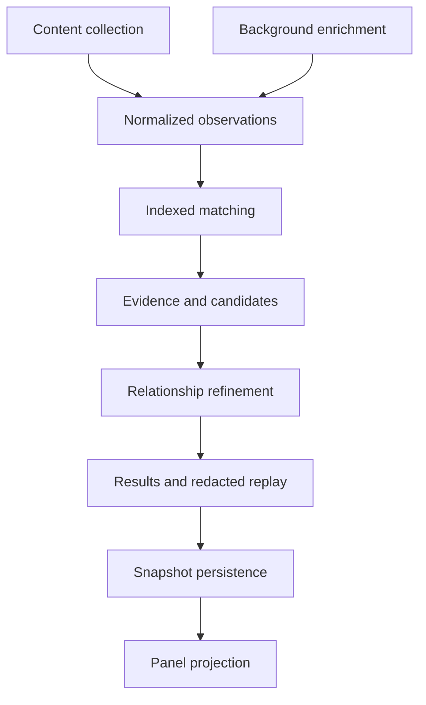

# Detection from page facts to visible results

DeepScope analyzes a supported browser tab locally. Content collects facts from
the document. Background adapters add privileged facts. Portable detection
turns observations into evidence, candidate technologies and final results.
The panel reads the latest stored result and follows accepted revisions.

The source owners are described in [source ownership](source-layout.md).
`packages/dom` owns selector planning and matching. `packages/registry` owns
technology definitions and schema. `packages/detection` owns the computation
and compiler. `apps/extension` owns browser access, scheduling, persistence,
worker hosting and Solid UI. No portable package imports the extension.

## One scan and its lifetime

The mounted panel resolves a browser window and exact tab identity, or follows
a pinned target from a full-page surface. Automatic tab events enter the same
background analysis scheduler. Background validates the current document,
checks a matching snapshot, and injects content only when collection is needed.

Content returns normalized observations. Background enrichment can read selected
page-owned globals, same-origin response headers, and bounded script or style
text. Matching runs through the chosen browser worker adapter. The compiler's
rule-free runtime artifact serves planning and relationship work; matcher
workers load only the observation-kind shards they need.

A matcher result can publish only while it still owns the current document and
visible session. Snapshot writes retain their ordered fence. Tab activation
changes priority; it does not cancel admitted work. Navigation and tab closure
abort document work and revoke publication ownership before cleanup proceeds.
An already-submitted adapter write cannot be canceled by those in-memory fences.

## Persistence and recovery

`DetectionSessionSnapshot` stores normalized `SiteAnalysis`, session identity,
enrichment state and a compact replay summary. Content writes small lifecycle
revisions; background writes detector revisions; the panel reads and subscribes
through persistence capabilities. The concrete browser adapter owns storage.

Stored results do not contain raw HTML, cookie values, storage values, source
bodies or complete observation batches. Replay stores redacted diagnostics and
per-detection explanations. Private-tab policies remain explicit in the
existing producers and stores; a local type check does not prove the complete
private browsing journey.

A live observation refresh combines the existing event batch with late facts,
deduplicates observations and reruns matching and relationship refinement. It
does not append final detections, because `implies`, `requires` and `excludes`
need the complete candidate set. If background memory is lost, recovery
recollects the current document. Durable intent and matcher records identify
interrupted work; they do not preserve an in-memory batch for continuation.

## UI ownership

One `PanelProvider` retains state across Summary, Technologies, History,
Diagnostics and Settings routes. Its operations live in `app/panel/`; browser
and persistence implementations live in `app/browser/`. Pure projections live
in `app/model/`. The independent options page can show diagnostics without the
panel state owner.

Opening the panel or pressing Refresh may start one panel-owned observation.
Switching tabs or closing the panel requests an exact-target stop. A delayed
response cannot overwrite a newer target. Automatic scans remain one-shot
work and do not retain a panel observer on each tab.

## Verification limits

The lifecycle, privacy, queue, storage, detector and panel tests protect the
source contracts. Generated-artifact inspection protects packaging and data
formats. Real browser scenarios must additionally cover worker suspension,
content injection, toolbar gestures, tab races, observation disposal, private
windows and memory recovery. Follow the [verification workflow](verification-workflow.md)
and record unrun browser gates separately from passing builds.
