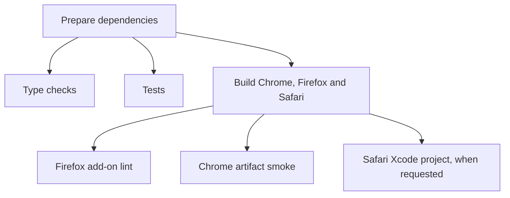

# DeepScope CI

Two workflows live in `.github/workflows/`:

| Workflow | Trigger | Purpose |
| --- | --- | --- |
| `verify.yml` (**Verify**) | every pull request, pushes to `main`, manual | type checks, the full Vitest suite, Chrome/Firefox/Safari builds, Chrome artifact smoke, Firefox add-on lint, workflow lint |
| `release.yml` (**Release**) | `v*` tags, manual dry run | release archives, `SHA256SUMS`, provenance, GitHub Release, ghcr.io; see [release/README.md](release/README.md) |

Both call the same Mise tasks a developer runs locally, so a CI failure can be
reproduced with the command shown in the failing step.

## Local commands

Tools are pinned in the root `mise.toml` (Node, pnpm). Task files under
`.mise/tasks/` are thin wrappers that pass arguments to the package scripts or
native tools; the root `package.json` scripts stay the owner of what "compile"
and "test" mean, delegating to `apps/extension` (`@deepscope/extension`) where
the app owns the command.

| Command | Runs |
| --- | --- |
| `mise run check` | `pnpm run compile`: native checks for every `packages/*` and `tools/*` workspace, then TypeScript for `apps/extension`, `utils` and the root config files |
| `mise run test [vitest args]` | `pnpm run test:run` — Vitest discovers every test through the projects in the root `vitest.config.ts` (`apps/extension` contributes `extension (runtime)` and `extension (ui)`) |
| `mise run build <chrome\|firefox\|safari>` | `wxt build -b <browser> --mv3` in `apps/extension`, into the root `.output/<browser>-mv3` |
| `mise run zip <chrome\|firefox\|safari>` | `wxt zip -b <browser> --mv3`; Firefox also writes a sources zip |
| `mise run lint:firefox [dir]` | Mozilla `web-ext lint` on an unpacked Firefox build |
| `mise run lint:workflows` | `actionlint` with pinned ShellCheck, and `zizmor --offline` on `.github/` |
| `mise run prepare:chromium` | hosted Ubuntu only: verify the selected Chromium path and load its AppArmor user-namespace profile |
| `mise run release:archives [browsers]` | zips each browser, then writes release-named archives and `SHA256SUMS` to `.output/release` |
| `mise run release:check-version <tag>` | fails unless the tag equals the `apps/extension/package.json` version |
| `mise run safari-project` | macOS only: wraps the Safari build in an Xcode project and builds it unsigned |
| `pnpm run validate:chrome-artifact` | reads the built Chrome files and opens the generated panel and options pages in Chromium or Chrome for Testing |

`--mv3` is passed explicitly because WXT 0.21 builds Firefox and Safari as MV2
unless `wxt.config.ts` sets `manifestVersion: 3`. It is harmless once it does.

No task lists individual test, source or benchmark files. A new test under
`apps/extension/src/tests/` is picked up by Vitest without editing any task or workflow.

## Verify workflow

Workflow lint runs independently of these jobs.

- **prepare** runs `pnpm install --frozen-lockfile` once and, on trusted refs
  only, saves the download caches. Every other job restores them read-only and
  installs again (an install from a warm store takes seconds).
- **build** uploads each browser's zips as the `extension-<browser>` artifact
  (7-day retention) for review. Release archives are never taken from these;
  the release workflow rebuilds from the tag.
- **lint-firefox** unpacks the Firefox build and runs `web-ext lint`. It fails
  on lint *errors* (for example a missing `browser_specific_settings.gecko.id`),
  which is what addons.mozilla.org rejects. The current WXT manifest includes
  the add-on id; the lint result still depends on the generated archive.
- **smoke-chrome** runs `pnpm run validate:chrome-artifact` against the CI
  Chrome build. It requires exactly one downloaded Chrome archive and fails if
  the script or a compatible browser is unavailable. The step sets
  `CHROME_BIN=/usr/bin/chromium` and prints that executable's version before
  validation. The hosted image owns Chromium installation; no second browser
  download is needed. A static artifact check does not replace this browser
  startup check. The job creates the extraction directory before unpacking the
  downloaded archive. A failed launch reports its process status and bounded
  stderr; cleanup failure remains a separate failed assertion.
- **safari-xcode** is an optional packaging check that needs Apple's macOS
  tools. It runs when a PR carries the `ci:safari` label or a manual run sets
  the `safari-xcode` input.
- **workflows** lints the workflow files with actionlint 1.7.12, ShellCheck 0.11.0
  and zizmor 1.32.0. The task resolves ShellCheck explicitly, so local and hosted
  runs use the same version and a missing executable cannot silently skip it.
  `.github/zizmor.yml` disables only the
  `self-repository` audit: zizmor prefers `uses: $/...`, which actionlint
  1.7.12 still rejects.

Every job has a timeout, every action is pinned to a full commit SHA with its
version in a comment, and every checkout uses `persist-credentials: false`. The
workflow token is `contents: read` throughout.

### Runners

Most jobs use GitHub-hosted `ubuntu-24.04`; the optional Xcode job uses
`macos-15`. [Standard GitHub-hosted runners are free for public repositories](https://docs.github.com/en/billing/concepts/product-billing/github-actions).
The old fixed macOS billing multiplier does not describe this public
repository's standard runners. The previous workflow used
Ubicloud's `ubicloud-standard-2`; to return to it, change `runs-on` in
`verify.yml` (release jobs should stay GitHub-hosted so provenance does not
name a third-party runner).

The [Ubuntu image installs both branded Chrome and Chromium](https://github.com/actions/runner-images/blob/main/images/ubuntu/scripts/build/install-google-chrome.sh),
but its default `CHROME_BIN` points to branded Chrome. Chrome 137 removed
[`--load-extension` support from branded builds](https://groups.google.com/a/chromium.org/g/chromium-extensions/c/1-g8EFx2BBY).
Chromium and Chrome for Testing retain that development flag. The smoke job
therefore selects the image's Chromium explicitly. Its version follows the
hosted image and is recorded in each run; it is not a separately pinned browser
release. Local runs must select a supported executable in the same way.

Ubuntu restricts unprivileged user namespaces. Before validation,
`mise run prepare:chromium` loads one AppArmor profile that grants `userns` to
`/usr/local/share/chromium/chrome-linux/chrome`, following
[Chromium's executable-specific configuration](https://github.com/chromium/chromium/blob/158.0.8127.0/docs/security/apparmor-userns-restrictions.md).
The task requires `CHROME_BIN` to resolve to this exact path and checks that the
executable and every parent directory belong to root and cannot be written by
the runner. It prints their ownership and modes before loading the profile.
An unexpected or writable installation fails before any host policy change.

The profile is a specific exception to Ubuntu's user-namespace restriction;
the global restriction stays enabled. Chromium runs as the ordinary hosted
user and applies its own namespace and seccomp sandbox. The task loads only
this profile into the ephemeral runner. It does not download browser code,
change executable permissions, or disable the browser sandbox. The subsequent
smoke check must establish actual startup and generated-page behavior.

The earlier SUID-helper attempt failed before launch in
[run 46135269877](https://github.com/Kaiju-Ind/DeepScope/actions/runs/46135269877).
The exact image's [system setup](https://github.com/actions/runner-images/blob/ubuntu24/20261122.23/images/ubuntu/scripts/build/configure-system.sh)
makes `/opt` writable, so the helper under `/opt/google/chrome` is not a suitable
privileged installation to reuse. The current task does not grant it SUID
permissions or copy it into a privileged execution path.

### Concurrency

Automatic runs cancel an outdated run for the same PR or branch. Manual runs
are grouped by commit SHA and never cancel a build that already started.

## Dependency caching

Cache layers and their owners:

| Layer | Owner | Written by | Read by |
| --- | --- | --- | --- |
| Node/pnpm binaries | `jdx/mise-action` | `prepare` on trusted refs | all verify jobs |
| pnpm download store (`$RUNNER_TEMP/pnpm-store`) | `actions/cache` save/restore | `prepare` on trusted refs | all verify jobs |
| `node_modules`, WXT output, test results | not cached | — | — |
| release archives | release workflow artifact | release `build` job | later release jobs |

The pnpm key is `deepscope-pnpm-v2-<os>-<arch>-<node>-<pnpm>-<hash of mise.toml,
mise.lock, pnpm-lock.yaml, pnpm-workspace.yaml and every workspace package.json>`. `prepare`
recomputes it after a successful install and saves only a miss whose inputs did
not change. A cache failure never skips the frozen install.

**Trusted writers** (`TRUSTED_CACHE_WRITER` in `verify.yml`): pushes to `main`
or a protected branch, same-repository non-fork PR merge refs, and manual runs
on branches. Fork PRs read caches but never write them. GitHub scopes PR caches
to the PR's merge ref, so a PR cannot write a cache that `main` or a tag reads.
The release workflow goes further and restores **no** cache at all: it installs
cold from the lockfile so nothing a PR run produced can reach a published
archive.

A cache hit is not evidence that a test or build ran; each job executes its
command every time. Each build produces fresh WXT output from its checkout.
`wxt.config.ts` derives the diagnostic build identity from the package version
and source commit, and fonts come from pinned workspace dependencies.

### Native task-cache experiment (November 2026)

Mise stored a 546-byte type-check result in one run and restored it in the
next, but still reported `cache miss` and re-ran `tsc --noEmit` (Actions run
42711392941 on the former private repository). The result cache was removed.
Keep type checks executing on every PR update until the WXT-generated input
closure gives a stable key and a measured saving.

## Required checks and branch settings

The checks a branch rule should require are **Type checks**, **Tests**,
**Build (chrome)**, **Build (firefox)**, **Build (safari)**, **Firefox add-on lint**,
**Chrome artifact smoke** and **Workflow lint**. The Chrome job executes its
validator on every run; it no longer has a successful "script absent" path.
Verify that the runner provides a compatible browser before requiring the
new check in a ruleset. The previous single
check names (`Type checks` / `Tests and Chrome build (manual)`) are replaced;
an owner must update any ruleset that names the old ones.

## Dependency updates

`renovate.json` is self-contained (the repository is public and cannot extend a
private preset):

- `config:best-practices`, which pins GitHub Actions and Docker digests;
- one grouped PR for minor, patch, pin and digest updates, scheduled early
  Monday (UTC), plus monthly lock-file maintenance;
- `minimumReleaseAge: 3 days` for ordinary updates;
- vulnerability fixes (GitHub and OSV advisories) open immediately, outside the
  schedule and without the release-age wait, labelled `security`;
- the Solid 2 major is held back until its UI dependencies support it;
- custom managers update the tool versions pinned inside `.mise/tasks/*`
  (`#MISE tools={...}`) and the Mise version passed to `jdx/mise-action`.

## Timing

The [active migration record](migration/monorepo-plan.md) records an identified
successful hosted run with actual job timestamps, elapsed wall time and summed
executed-job duration. These measure one source/tool/cache condition; they are
not a general performance guarantee or billing-rounded usage. Compare the same
conditions and retain failed runs before changing the job split or adding caches.
