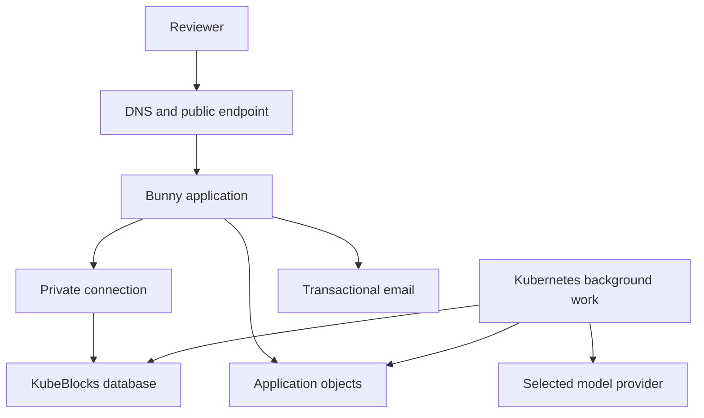

# Choose ownership and placement separately

Use the [generic profile](../profiles/generic.md) unless the project selects Kaiju's platform. The artifact ownership
principle applies across products and runtimes; the providers, JavaScript examples and deployment patterns below are
preserved Kaiju cases. Choose the actual supported runtime and placement from the customer's journey and current source.
An isolated product experiment does not require deploying this architecture.

Classify each component. One repository can contain several strategies.

| Artifact strategy                           | What the project maintains                                                              | How an update arrives                                            | First checks                                                                                                      | Typical adaptation                                                                 |
| ------------------------------------------- | --------------------------------------------------------------------------------- | ---------------------------------------------------------------- | ----------------------------------------------------------------------------------------------------------------- | ---------------------------------------------------------------------------------- |
| Upstream image                              | Deployment, supported configuration, optional thin image layer, integration tests | Grouped Renovate change to version and digest                    | Actual image architecture, entrypoint, health, writable paths, migration command, license/edition features        | Configure environment, mount a supported config file, provision a supported plugin |
| Published JavaScript package or pinned file | Small launcher or adapter, exact dependency lock, packaging and integration tests | Dependency update or an explicitly reviewed source-file revision | Public exports or executable entry point, runtime support, installed artifact, startup/exit, dependency integrity | A Deno or Node entry point, then a thin OCI image when the host requires one       |
| Owned application source                    | Application behavior and patch set as well as deployment                          | Upstream source integration plus owned changes                   | Real upstream ancestry or import record, framework/runtime, licenses, migrations, tests and extension seams       | Maintained fork or source import with a controlled update procedure                |

Do not download a moving JavaScript URL at container startup. Pin the file's source revision and integrity, keep
dependencies reproducible, and package the verified result. If a published package lacks the needed public entry point,
do not invent one or import private source paths. Select a supported image, an extension API, or owned source.

Prove each requirement before it creates maintenance work. An imported database version floor, copied scaffold or
familiar example does not establish what the application needs. Trace the actual client, migration and compatibility
requirements, then try the existing supported platform contract. A new database image, source fork or shared package
needs a demonstrated gap, an owner, an upgrade path and a removal condition.
[The supplied OpenATS retrospective](../failures/retrospectives/README.md) records how an unproved PostgreSQL patch
floor created a custom-image workstream that was later removed.

ItsAPlan combines upstream application images, a locally prepared image consuming `@itsaplan/runner` and OpenCode, and
owned Deno/Pulumi tooling. OpenATS owns application source. The inspected Grafana and Twenty projects are image
wrappers; their npm manifests also manage infrastructure or supporting tools. Running `node` inside an image does not
establish a package-based application integration. The primary files of each example:

| Example                                    | Primary files                                                                                                                                                                                                                                                                                                                                                                            | Interpretation                                                                                       |
| ------------------------------------------ | ---------------------------------------------------------------------------------------------------------------------------------------------------------------------------------------------------------------------------------------------------------------------------------------------------------------------------------------------------------------------------------------- | ---------------------------------------------------------------------------------------------------- |
| ItsAPlan upstream app plus packaged runner | [images](https://github.com/Kaiju-Ind/ItsAPlan/blob/8dbe104fff3ca8b5f930aecbe2891eaeb2e0a2c5/infra/images.json), [runner owner](https://github.com/Kaiju-Ind/ItsAPlan/tree/8dbe104fff3ca8b5f930aecbe2891eaeb2e0a2c5/agents/runner)                                                                                                                                                       | Classify each component separately                                                                   |
| Grafana image wrapper                      | [Dockerfile](https://github.com/Kaiju-Ind/Grafana/blob/855411210234b958872d4806c8b71376a3dc8a4e/Dockerfile), [root package](https://github.com/Kaiju-Ind/Grafana/blob/855411210234b958872d4806c8b71376a3dc8a4e/package.json), [infra package](https://github.com/Kaiju-Ind/Grafana/blob/855411210234b958872d4806c8b71376a3dc8a4e/infra/package.json)                                     | Grafana Foundation SDK generates supporting configuration; it is not the Grafana server distribution |
| Twenty image wrapper                       | [Dockerfile](https://github.com/Kaiju-Ind/Twenty/blob/51e7fabdb445b79adc24b73f1fada8f7fd497498/Dockerfile), [package](https://github.com/Kaiju-Ind/Twenty/blob/51e7fabdb445b79adc24b73f1fada8f7fd497498/package.json)                                                                                                                                                                    | A Node entry point inside an upstream image does not establish a published application package       |
| OpenATS owned source/import                | [requested source](https://github.com/Kaiju-Ind/OpenATS/blob/3b30f7e34a16dca68fe1ac354438ea93ef6fad26/upstream/requested.env), [integrated source](https://github.com/Kaiju-Ind/OpenATS/blob/3b30f7e34a16dca68fe1ac354438ea93ef6fad26/upstream/integrated.env), [upgrade procedure](https://github.com/Kaiju-Ind/OpenATS/blob/3b30f7e34a16dca68fe1ac354438ea93ef6fad26/docs/upgrades.md) | A Renovate proposal must be followed by actual source integration                                    |

## Give a built dependency its own package

A repository often builds and runs something that its code depends on but does not author: a database, a scheduler, a
patched upstream image. Give it a package, the way a database package owns its schema, migrations and client. The
package holds the recipe that builds the dependency and the client that the project's code uses to reach it (for example
`packages/inngest/` with `image/` and `src/client.ts`). Nothing else constructs that client. `infra/` stays the
deployment program that places the result, `services/` what the project exposes, and `workers/` its own background code.

Choose placement from the actual project contract. The [Kaiju profile](../profiles/kaiju.md) preserves these two
reviewed platform patterns; they are not an exhaustive list of deployment options:

| Placement             | Use when                                                                                                           | Owned application resources                                                                                                | Extra checks                                                                                                                        |
| --------------------- | ------------------------------------------------------------------------------------------------------------------ | -------------------------------------------------------------------------------------------------------------------------- | ----------------------------------------------------------------------------------------------------------------------------------- |
| Kubernetes-only       | The application fits the existing cluster, ingress and data path; a separate edge runtime adds little value        | Deployment/StatefulSet/Job as appropriate, Service, existing ingress integration, app secrets, database/storage allocation | Cluster identity/RBAC, probes, persistence, ingress/TLS, rollout and actual user flow                                               |
| Bunny plus Kubernetes | Public application workloads benefit from the existing Bunny setup while data or durable work stays in the cluster | Bunny application and endpoints; Kubernetes data/background workloads; explicit private connection                         | Bunny process semantics, registry pulls, Tailscale identities/bridge, health-probe reachability, DNS/CDN/cookies and runtime egress |

Kubernetes-only does not require Magic Containers, a Tailscale bridge or a new sandbox provider. It can still use an
existing Bunny edge arrangement if that is the platform's exposure contract. Select the supported path with the fewest
new dependencies for the requested outcome. Keep existing platform choices unless a traced limitation requires change.

## Keep shared platform work off the repeat deployment path

The platform owns the cluster, controllers, storage classes, backup infrastructure, shared network operators and base
registry/DNS access. An instance owns its application resources and data. The application owns its schema, accounts and
business behavior.

| Owner                | Examples                                                                                                                                   | Reuse rule                                                                                        |
| -------------------- | ------------------------------------------------------------------------------------------------------------------------------------------ | ------------------------------------------------------------------------------------------------- |
| Shared platform      | Cluster, KubeBlocks operators/catalog, `lair`, data-node pool, StorageClass, BackupRepo, Tailscale operator, registry connection, DNS zone | Borrow through verified outputs. Do not create, adopt or delete these from every app stack.       |
| Application instance | Named DB/role, workload secrets, Jobs, worker, endpoints, DNS records, B2 allocation and optional runner workspace                         | Give resources explicit instance identity and lifecycle. Retain stateful resources intentionally. |
| Application          | Migrations, first administrator, memberships, email integration, model configuration and task protocol                                     | Use supported configuration and administration APIs. Do not patch an edition limit away.          |
| Deployment operation | Candidate identity, saved plan, maintenance, phase record, acceptance and recovery                                                         | One active deployment owner per instance. Preserve partial-state evidence.                        |

This split follows
[ItsAPlan's repository ownership](https://github.com/Kaiju-Ind/ItsAPlan/blob/8dbe104fff3ca8b5f930aecbe2891eaeb2e0a2c5/AGENTS.md).
It prevents an application setup from becoming an accidental platform rebuild.

The hybrid example below shows ownership and connectivity. It does not prescribe every component for every project.

The private connection must be tested from the deployed workload. A successful laptop connection does not prove the
application's route. A background worker is a real process role even when it shares an image with the API. OpenATS's API
and Worker use the same backend artifact but have different commands and exposure.

## Treat instances, tenants and execution isolation as different contracts

An application workspace is not automatically a strong tenant boundary. Verify upstream edition support, authorization,
credentials, object paths and data scope. Use separate instances when independent data or policy is required and the upstream tenant model is insufficient.
The original Kaiju examples used separate stacks for ThunderStrike and Kaiju.

Do not share a bucket merely because credentials differ. ItsAPlan's upstream object keys do not include an installation
prefix, so independent installations need separate buckets. A schema, namespace or prefix can help organize data, but
its isolation depends on enforced access controls. Current examples use shared platform infrastructure; they do not
promise isolation from cluster administrators.

Coding agents need a separate decision. A persistent upstream runner can work without a custom Kubernetes operator.
Per-task sandboxing adds claims, resource limits, credentials, cancellation, stale-result rejection, artifact custody
and cleanup. A Pod launcher alone does not supply that execution protocol.
[Agent source and limits](https://github.com/Kaiju-Ind/ItsAPlan/blob/8dbe104fff3ca8b5f930aecbe2891eaeb2e0a2c5/infra/agents.ts).
