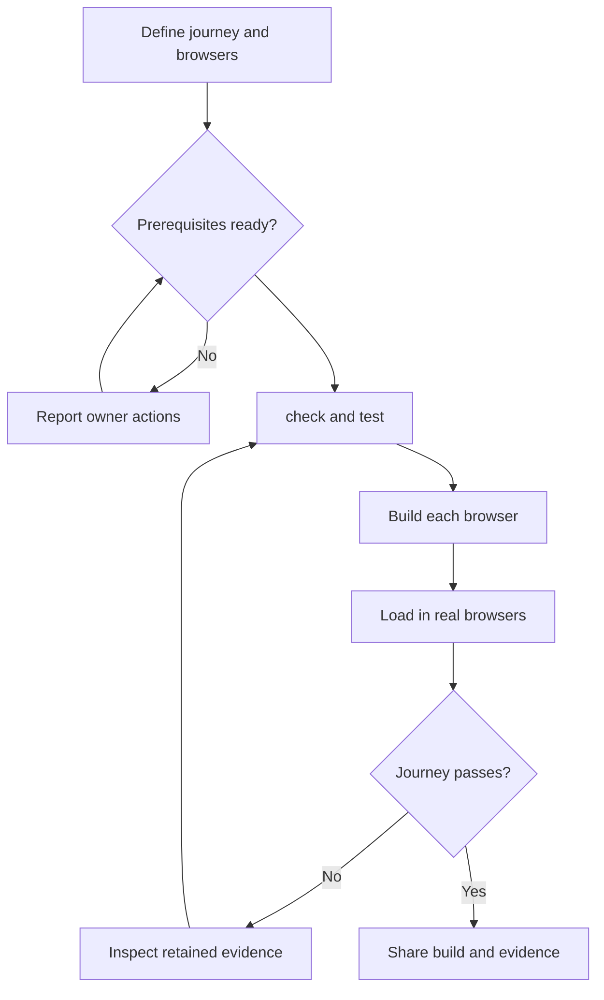

# Make the preview path short and complete

Start the owner-action report early. Resolve cheap failures before slow ones: a frozen install, type errors, a missing
manifest key, a `web-ext lint` error. Run independent checks concurrently where they do not share output.

Build every browser the change can affect. A Chrome-only check misses Firefox's event page and Safari's background page.
Reuse the exact build for diagnosis instead of rebuilding. The Verify workflow's `extension-<browser>` artifacts are the
same build for review.

Use synthetic pages for repeatable checks (the fixtures in `tools/verify/fixtures.mjs`) and a few real sites for
coverage. Keep page data out of committed files.

Only then give the reviewer the preview receipt: commit, build, browsers and versions, journey result, limitations. A
passing unit test cannot stand in for the toolbar badge, the panel or a private window.
