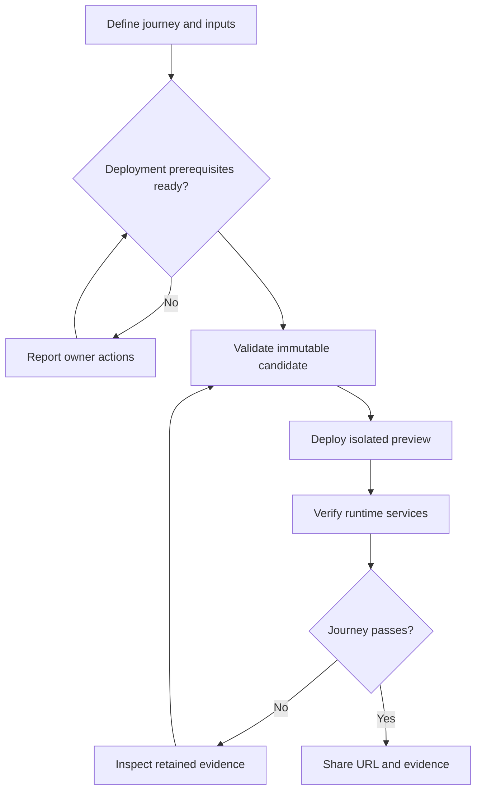

# Make the preview path short and complete

The following is the **target procedure**, not a claim that automatic preview environments already exist.

Start the owner-action report early. Resolve cheap failures before expensive builds: package access, missing artifact
versions, native generator availability, registry pulls, target network, installed database catalog, storage endpoint
and email sender. Check every locked private dependency together rather than discovering them one CI failure at a time.

Prepare the shared foundation once. Reuse a maintained platform profile, wildcard DNS/TLS arrangement or image cache
only when its actual readiness and scope are known. A first preview can use an isolated persistent environment while
full per-PR lifecycle automation is being built. Give each preview an owner, unique data identity and expiration policy.

Build only artifacts that Kaiju owns or adapts. Pull an unchanged upstream image by digest. For owned source, cache
dependencies and build stages by the inputs that affect them. Run independent source, type, behavioral and image checks
concurrently where their resources permit it. Never run competing database migrations or stack mutations concurrently.

Reuse the exact verified image for diagnostics and, when the repository's source/provenance contract permits it,
subsequent deployment. OpenATS already has a `smoke-existing` operation to inspect a published candidate without
rebuilding it. If a task fails after publication, diagnose the existing digest before scheduling another full
multiarchitecture build. Preserve exact-source tagged-release admission even when effective application inputs are
unchanged; a supported native recovery path does not waive the ordinary release contract.

Choose the required platform matrix explicitly. Test each production-required image platform before promotion. A faster
single-platform developer preview is useful, but it does not validate an untested production platform. Record the OCI
index and selected child digest where multiarchitecture artifacts are involved.

The preview must have the right origin, callbacks, cookies, uploads, queues and outbound transport for its journey. Keep
production credentials and data out of disposable environments. Use synthetic records and approved test recipients. If
the app does not support runtime public URLs, changing compiled configuration creates a new artifact that must be
validated.

Only then publish the preview receipt: URL, access method, source and artifact identity, passed journey, limitations,
logs/evidence location, owner and cleanup time. A successful `/health` response is one diagnostic result; it cannot
stand in for an invitation, upload or agent task.
